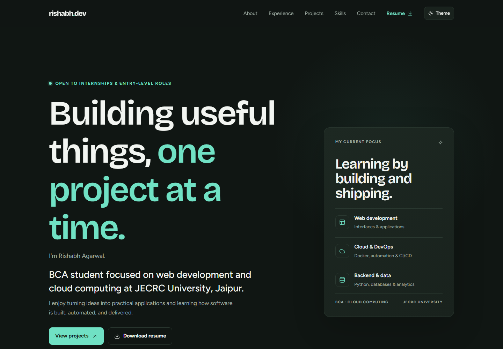
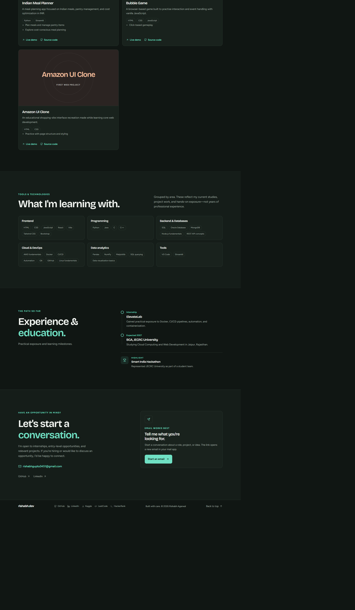

# Rishabh Agarwal — Developer Portfolio

A personal portfolio highlighting my web development and cloud computing interests, selected projects, and practical experience. I am pursuing a BCA at JECRC University in Jaipur and have completed a DevOps internship at ElevateLab.

**Live portfolio:** [portfolio-me-lac-eta.vercel.app](https://portfolio-me-lac-eta.vercel.app/)

## Screenshots

### Home



### Projects and experience



## Featured project

### Reelcast — Video Streaming Platform

The portfolio's featured project is a video-streaming platform with adaptive streaming, synchronized watch parties, and subscription billing.

- [Live demo](https://video-streaming-platform-theta-gilt.vercel.app/)
- [Source code](https://github.com/rishabh506/video-streaming-platform)
- Built with React, TypeScript, Node.js, Express, PostgreSQL, Redis, FFmpeg, Socket.io, AWS S3, and Stripe.

Other projects shown on the portfolio include Tic-Tac-Toe, Indian Meal Planner, Bubble Game, and Amazon UI Clone.

## About

- **Education:** Bachelor of Computer Applications, specializing in Cloud Computing and Web Development, JECRC University.
- **Experience:** DevOps internship at ElevateLab, with practical exposure to Docker, CI/CD pipelines, automation, and containerization.
- **Leadership:** Team head in the JECRC University Student Council management team, leading more than 80 students.
- **Interests:** Frontend and backend development, cloud computing, DevOps, databases, and data analytics.

## Portfolio features

- Project cards with category filters and links to source code and live demos.
- Dark and light themes.
- Resume download and direct email contact.
- About, projects, skills, experience, education, and contact sections.
- Links to GitHub, LinkedIn, Kaggle, LeetCode, and HackerRank.

## Run locally

This is a static site and has no package-install or build step. To serve it locally with Python:

```bash
python -m http.server 8000
```

Then open [http://localhost:8000](http://localhost:8000).

> **Source note:** In the current checkout, `style.css` and `script.js` are empty. The screenshots above show the deployed site; restore those source files before expecting the local preview to match it.

## Links

- [GitHub](https://github.com/rishabh506)
- [LinkedIn](https://www.linkedin.com/in/rishabh-agarwal-a70384321/?skipRedirect=true)
- [Kaggle](https://www.kaggle.com/rishabhagarwal997889)
- [LeetCode](https://leetcode.com/u/rishabh50666/)
- [HackerRank](https://www.hackerrank.com/profile/rishabhgupta3451)
- [Email](mailto:rishabhgupta3451@gmail.com)
